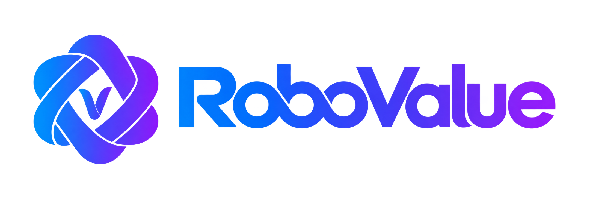
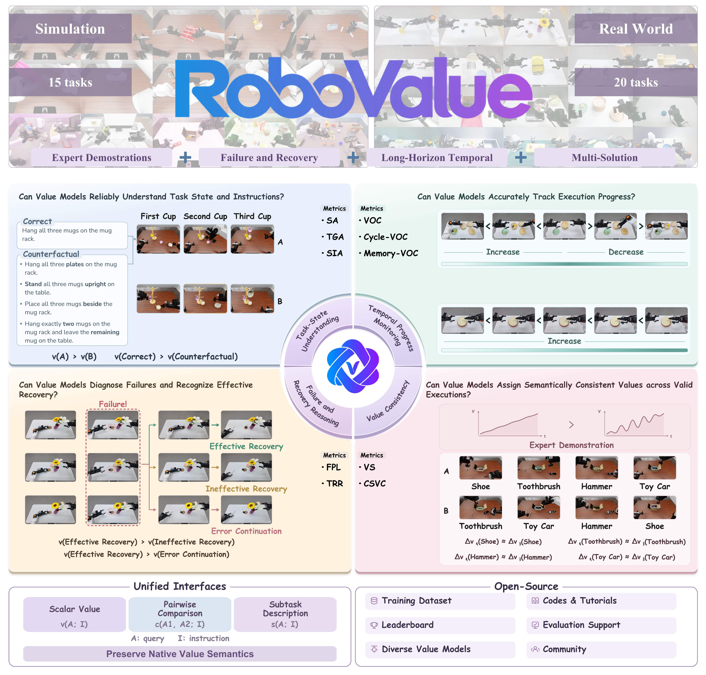
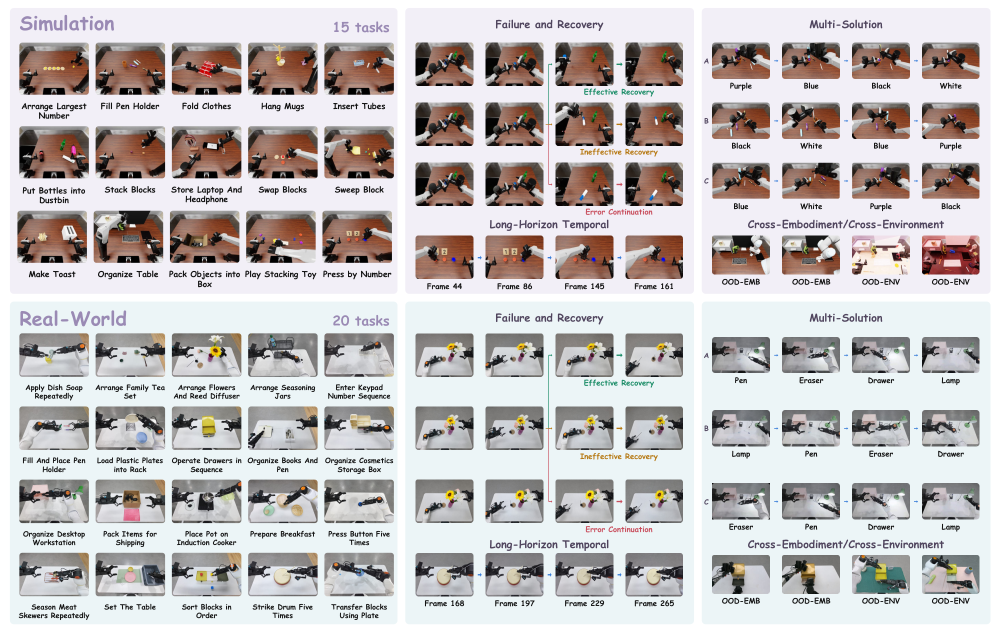
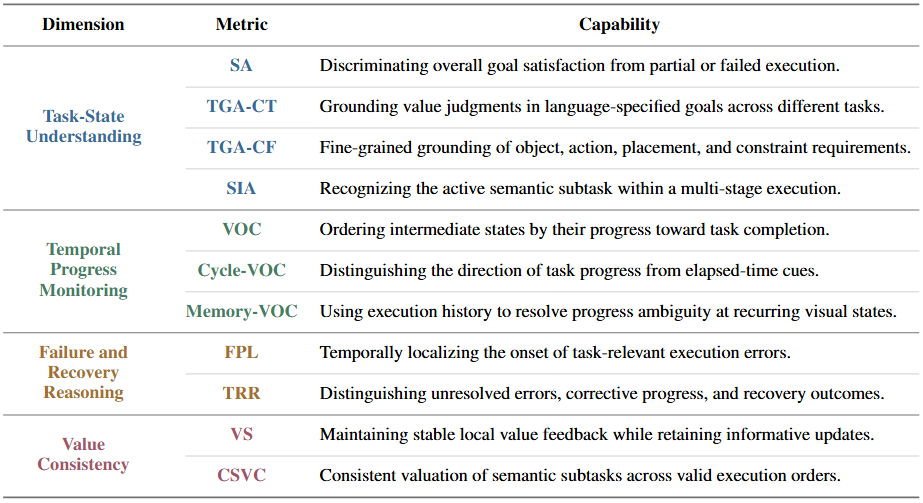

<div align="center">
  
</div>

<div align="center">
  <a href="https://robovalue.github.io/">Website</a> ·
  <a href="https://robovalue.github.io/doc/">Documentation</a> ·
  <a href="https://robovalue.github.io/leaderboard/">Leaderboard</a>
</div>

<div align="center">

[](README.md) [](README.zh-CN.md)

</div>

<h1 align="center">
  <sub>RoboValue: A Fine-Grained Sim-and-Real Benchmark<br />for Unified Evaluation of Robotic Value Models</sub>
</h1>

**RoboValue** is a fine-grained benchmark for evaluating how well robotic value models judge task success and execution progress. It covers **15 simulation and 20 real-world tasks**, testing task understanding, progress tracking, failure and recovery reasoning, and value consistency. With a shared evaluation protocol and leaderboard, RoboValue helps researchers compare models, diagnose unreliable feedback, and guide improvements for robot learning, planning, and execution monitoring.

The simulation and real-world **Full-Shot and One-Shot training subsets** use LeRobot v3.0. Dataset download links are withheld during anonymous review. The paper and current leaderboard report **Zero-Shot and One-Shot evaluations**.

<div align="center">
  <a href="docs/assets/overview-20261016.pdf"></a>
</div>

## ✨ Highlights

- 🤖 **RoboValue-Dataset.** Expert demonstrations and annotated test trajectories cover **15 simulation tasks** adapted from [RoboDojo](https://github.com/RoboDojo-Benchmark/RoboDojo/blob/main/README.md) and **20 real-world manipulation tasks**. Counterfactual instructions, recurring visual states with different histories, contrasting recovery outcomes, and alternative valid subtask orders expose specific errors in value judgments. Separate **cross-embodiment** and **cross-environment** settings test generalization.

- 🎯 **RoboValue-Benchmark.** A unified framework evaluates **four complementary capabilities**: task-state understanding, temporal progress monitoring, failure and recovery reasoning, and value consistency. A shared protocol compares models with different interfaces and value semantics, testing whether their feedback reflects how well task requirements are fulfilled throughout execution.

- 🏆 **RoboValue-Leaderboard.** We pair overall rankings with capability profiles and analyses of model failure modes. Strong outcome and forward-progress scores can coexist with poor instruction grounding, limited execution memory, incorrect recovery assessment, and inconsistent subtask credit. These findings identify supervision targets for more reliable value feedback in policy learning, action planning, and execution monitoring.

<div align="center">
  
</div>

<details>
<summary><strong>Overview of RoboValue Evaluation Metrics</strong></summary>

Fine-grained capabilities assessed within the four complementary evaluation dimensions.

<div align="center">
  
</div>

</details>

## 🧩 Supported Value Models

**✅** marks metrics supported by the current implementation in `base` mode; **—** means unsupported. See the [baseline guides](docs/baselines/README.md) or follow the model names for setup and scope, and [validation evidence](docs/testing.md) for tested coverage.

These models are optional evaluation baselines. Running the public CPU mock or integrating your own model does not require installing them.

| Model family | SA / TGA | SIA | VOC family | FPL / TRR | VS / CSVC | Config |
| --- | :---: | :---: | :---: | :---: | :---: | --- |
| [**FailSafe-labeled integration**](docs/baselines/failsafe.md) | — | ✅ | — | — | — | [YAML](configs/failsafeconfigs.yaml) |
| [**LIV**](docs/baselines/liv.md) | ✅ | — | ✅ | ✅ | ✅ | [YAML](configs/livconfigs.yaml) |
| [**ProcVLM**](docs/baselines/procvlm.md) | ✅ | ✅ | ✅ | ✅ | ✅ | [YAML](configs/procvlmconfigs.yaml) |
| [**Robo-Dopamine**](docs/baselines/robodopamine.md) | ✅ | — | ✅ | ✅ | ✅ | [YAML](configs/robodopamineconfigs.yaml) |
| [**RoboFAC**](docs/baselines/robofac.md) | ✅ | ✅ | ✅ | ✅ | ✅ | [YAML](configs/robofacconfigs.yaml) |
| [**RoboMeter**](docs/baselines/robometer.md) | ✅ | — | ✅ | ✅ | ✅ | [YAML](configs/robometerconfigs.yaml) |
| [**RoboReward**](docs/baselines/roboreward.md) | ✅ | — | ✅ | ✅ | — | [YAML](configs/roborewardconfigs.yaml) |
| [**RynnValue**](docs/baselines/rynnvalue.md) | ✅ | — | ✅ | ✅ | ✅ | [YAML](configs/rynnvalueconfigs.yaml) |
| [**TOPReward (Qwen / Molmo)**](docs/baselines/topreward.md) | ✅ | — | ✅ | ✅ | ✅ | [YAML](configs/toprewardconfigs.yaml) |
| [**VLAC**](docs/baselines/vlac.md) | ✅ | — | ✅ | ✅ | ✅ | [YAML](configs/vlacconfigs.yaml) |

## 🚀 Evaluate Your Model <a name="quick-start"></a>

The RoboValue team supplies the benchmark data. To submit a model, provide an **inference service (a callable model prediction API)** and a **model-specific adapter**; the **team reviews the integration, prepares queries, and computes and reports metrics**. The team retains the private test set, which is not publicly released for download or participant-side evaluation.

**1. Identify your model and evaluation track.**

Specify the model or checkpoint version, preprocessing and prompt revisions, and evaluation track. Keep these versions fixed during evaluation.

- **Zero-Shot:** use the model without task-specific adaptation or reference demonstrations.
- **One-Shot:** use **one expert demonstration per task**, selected from the training split, for **inference-time conditioning or task-specific adaptation**. In the reported experiments, Robo-Dopamine and VLAC use reference observations without updating model parameters, while ProcVLM uses the demonstration for LoRA fine-tuning.
- **Full-Shot:** train or fine-tune on the complete RoboValue training split and record the training setup. This release does not report Full-Shot evaluation results.

**2. Provide your inference service.**

The model can remain in your own environment. Provide a reachable endpoint and document its native input/output format and authentication requirements. The service receives the observations and instructions needed for inference; test labels and scoring remain with the organizers. If observations must stay within organizer-controlled systems, deploy the service there.

**3. Implement your model-specific adapter.**

Start from the [adapter interface](src/vmbmk/adapters/base.py) and [CPU mock adapter](src/vmbmk/adapters/mock_service.py). Prepare the camera views, history, sampled frames, padding, and preprocessing your model requires, then call the service and return its predictions. Document these input requirements and confirm the required observations are available. Implement only the supported `value`, `compare`, and/or `subtask` methods. Metrics unavailable because an operation is unsupported are reported as **N/A, not zero**.

**4. Hand over the integration for evaluation.**

Prepare an evaluation handoff with the adapter source and dependencies, an example configuration, service specification, model/preprocessing versions, evaluation track, and a runnable synthetic integration example. Share connection details and credentials privately; read credentials from environment variables. The team reviews the integration and runs the applicable metrics under the agreed protocol.

See [Service & Adapter](https://robovalue.github.io/doc/model-api/) for examples and the handoff checklist, and [Evaluation Workflow](https://robovalue.github.io/doc/get-started/evaluation/) for responsibilities and reporting.

<details>
<summary><strong>Adapter methods and prediction semantics</strong></summary>

| Method | Input per query | Returns |
| --- | --- | --- |
| `value` | One observation sequence and task instruction | A finite scalar in the model's native units |
| `compare` | Two observation sequences, ordered A then B, and a task instruction | A finite comparison score with documented direction |
| `subtask` | One observation sequence and task instruction | A nonempty predicted subtask description |

Each method accepts a batch of queries and returns one prediction per query in the same order. Preserve the model's native prediction target, units, and score direction; no common min–max normalization is required. Declare whether `compare` uses the model's native comparison or `V(b) − V(a)`; the value-difference helper is appropriate only when it matches the model's comparison semantics. These are explicit choices, not automatic fallbacks.

For SIA, return the predicted subtask description; the organizers' judge computes its score. Report service failures as errors, never as zero predictions or N/A.

</details>

<details>
<summary><strong>Run the public CPU mock check</strong></summary>

Start with **Python 3.10+**. Check your version with `python3 --version`; if it is older, replace `python3` in the environment-creation command below with an installed compatible interpreter, such as `python3.12`. These commands are for macOS / Linux:

```bash
GIT_LFS_SKIP_SMUDGE=1 git clone https://github.com/robovalue/RoboValue.git
cd RoboValue
python3 -m venv .venv
source .venv/bin/activate
python -m pip install PyYAML Pillow
PYTHONPATH=src:tests python -m unittest discover -s tests/adapters -p test_mock_service.py -v
```

The clone command skips large model-weight downloads. The tests generate temporary data and synthetic images to check the mock adapter with local toy predictions; a successful run ends with `OK`. No GPU, model checkpoint, running API, or private test data is needed. The check does not call your service or produce an official model evaluation.

For your integration, replace the mock's input preparation and prediction functions with your model's input policy and service calls, then validate them with a synthetic example. The [example configuration](configs/mock_service.example.yaml) illustrates the handoff format with placeholder paths.

</details>

<details>
<summary><strong>More documentation</strong></summary>

| Guide | Contents |
| --- | --- |
| [Baseline setup](docs/baselines/README.md) | Prerequisites and instructions for deploying selected baselines on the evaluation side |
| [Data preparation](docs/data.md) | Evaluation-side dataset structure, metadata, annotations, and asset paths |
| [Configuration and commands](docs/configuration.md) | YAML fields, evaluation modes, and CLI usage |
| [Service & Adapter](https://robovalue.github.io/doc/model-api/) | Provider handoff, native interfaces, references, and adapter examples |
| [Environment details](docs/environments.md) | Lockfiles, custom roots, and native builds |
| [Metric implementation notes](docs/metric_alignment.md) | Scoring alignment and protocol changes |
| [Result interfaces](docs/result_publication.md) | Validation, publication, and SIA intermediate outputs |
| [Developer guide](docs/developer_guide.md) | Package layout, call flow, and extension points |
| [Testing and evidence](docs/testing.md) | CPU tests, bounded model checks, and known limitations |

</details>

## 🗂️ Repository Structure

Main code, configuration, and entry points are shown below; some files are omitted:

```text
RoboValue/
├── configs/              # General, baseline, and mock evaluation templates
├── envs/                 # Model environment definitions, locks, and setup scripts
├── src/vmbmk/
│   ├── adapters/         # Model integrations and shared interfaces
│   ├── metrics/          # Query planning and metric scoring
│   ├── data/             # Dataset loading, validation, and playback code
│   ├── inference/        # Query/result types, inference dispatch, and workers
│   ├── runner/           # Evaluation, batching, and resume
│   ├── tools/            # Data checks, result handling, and visualization
│   └── cli.py            # Command-line entry points
├── docs/                 # Setup guides and protocol documentation
├── tests/                # Metric, adapter, and data tests
└── vmbmk.sh              # Evaluation launcher
```

## 🏆 Leaderboard

View rankings, capability scores, and model configurations on the [**RoboValue Leaderboard**](https://robovalue.github.io/leaderboard/). Evaluation settings describe how task-specific demonstrations are used:

| Setting | Task-specific demonstrations | How they are used | Reported evaluation results |
| --- | --- | --- | --- |
| **Zero-Shot** | None | No task-specific adaptation | ✅ Results available |
| **One-Shot** | 1 demonstration per task | Inference-time conditioning or task-specific adaptation | ✅ Results available |
| **Full-Shot** | Complete training split | Training or fine-tuning | — Not reported in this release |

The paper and current leaderboard report Zero-Shot and One-Shot results, using the same held-out test set and evaluation metrics with separate rankings. Training data is distributed separately from this source repository.

## 📄 License

RoboValue's own code, scripts, and documentation are released under the [MIT License](LICENSE). Third-party code, model weights, and datasets remain subject to their respective licenses and terms.
